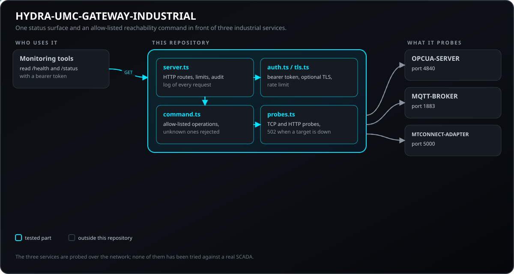
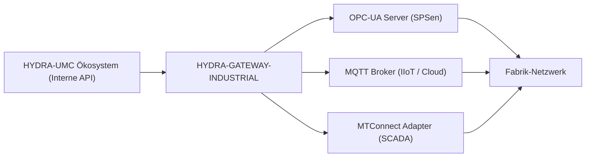
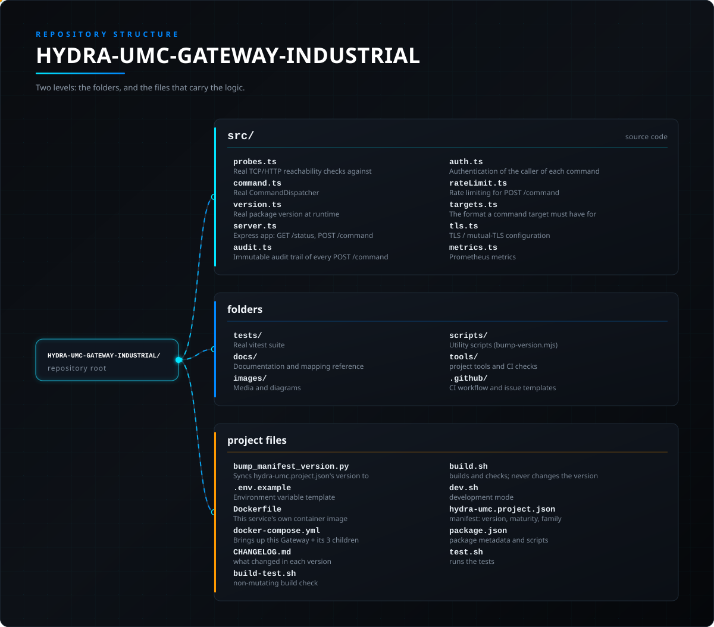

<!-- =============================================================================
HYDRA-UMC-GATEWAY-INDUSTRIAL - Single status surface in front of the industrial bridges
Copyright (C) JuanenRac (Electro Hobby 3D) <electrohobby3d@gmail.com>
GPL-3.0-or-later - see LICENSE
============================================================================= -->

<p align="center">
  
</p>

# 🌐 HYDRA-UMC-GATEWAY-INDUSTRIAL

<p align="center"><a href="README.md">🇺🇸 English</a> | <a href="README_spa.md">🇪🇸 Español</a> | <a href="README_fra.md">🇫🇷 Français</a> | <a href="README_ita.md">🇮🇹 Italiano</a> | 🇩🇪 <b>Deutsch</b> | <a href="README_zho.md">🇨🇳 简体中文</a> | <a href="README_jpn.md">🇯🇵 日本語</a> | <a href="README_por.md">🇵🇹 Português</a></p>

### 🏭 Industrie 4.0 Interoperabilitätsbrücke für Fabrikstandards

<p align="center">
  
  
  
  
  
  
  
</p>

---

> **Stand von Sicherheit (Safety) und Security:** Dieses Ökosystem ist kein zertifiziertes Sicherheitssystem. Es gibt noch keinen Hardware-E-STOP-Pfad, keine von der Firmware durchgesetzten Grenzen oder Verriegelungen und keinen verifizierten Bewegungsbefehl; Firmware-Images werden mit CRC32 und einem HMAC-SHA256 mit gemeinsamem Schlüssel geprüft, nicht mit einer asymmetrischen Signatur; TLS und gegenseitiges TLS sind optional und standardmäßig aus; noch keine eigene Platine wurde bestückt oder getestet. Lesen Sie die [Sicherheitsbasis](https://github.com/JuanenRac/HYDRA-UMC-DOCS/blob/main/docs/SECURITY_BASELINE.md) und das [Bedrohungsmodell](https://github.com/JuanenRac/HYDRA-UMC-DOCS/blob/main/docs/THREAT_MODEL.md), bevor Sie sich für die Sicherheit einer Person auf eine Aussage hier verlassen.

---

## 📋 Auf einen Blick

| | |
|---|---|
| Version | `0.1.6` |
| Reifegrad | Funktionsfähig |
| Tests | 127 (`npm test`) |
| Technik | Node.js / Express / real TCP/HTTP reachability probes |
| Ziel | Der Raspberry Pi CM5 einer HYDRA-UMC-Zelle |
| Auf echter Hardware | Noch nicht: für diese Version ist kein Lauf auf echter Hardware vermerkt |

**Springe zu:** [Überblick](#-überblick) · [Architektur](#-architektur) · [Schnellstart](#-schnellstart) · [Tests](#-tests) · [Struktur des Repositorys](#-struktur-des-repositorys) · [Verwandte Projekte](#-verwandte-projekte)

## 🚦 Projektstatus

Jede Zeile ist ein Teil dieses Repositorys, und die Ampel sagt, wie weit er heute ist. Sie beruht auf dem, was das Repository zeigen kann (Tests, Builds, Läufe), nicht auf dem, was geplant ist.

🟢 Fertig und überprüft · 🟡 Funktioniert, mit bekannten Grenzen · 🟠 Teilweise fertig oder noch nicht überprüft · 🔴 Nicht gemacht oder funktioniert nicht

| Bereich | Stand | Was das hier bedeutet |
|---|---|---|
| Software | 🟡 | Funktioniert für seinen Hauptzweck; die Ehrlichkeitsprüfung oben nennt, was noch fehlt |
| Tests | 🟢 | 127 automatische Tests, bei jeder Änderung ausgeführt |
| Echte Hardware | 🔴 | Noch nicht: für diese Version ist kein Lauf auf echter Hardware vermerkt |
| Dokumentation | 🟢 | README in acht Sprachen, bei jeder Änderung gegen das Manifest geprüft |

## 🎯 Überblick

**HYDRA-UMC-GATEWAY-INDUSTRIAL** ist die Kommunikationsbrücke zwischen dem HYDRA-UMC-Ökosystem und externen Industriestandards. Es ermöglicht der Micro-Factory die Interaktion mit SPSen von Drittanbietern, SCADA-Systemen und cloudbasierten IIoT-Plattformen.

Heute ist es die einzige Statusfläche vor dem OPC-UA-Server, dem MQTT-Broker und dem MTConnect-Adapter: Es prüft, ob jeder von ihnen läuft und antwortet, und nimmt eine Liste erlaubter Befehle an, deren einzige Wirkung die Prüfung ist, ob das Ziel erreichbar ist. Den internen Roboterzustand in deren Adressräume zu übersetzen ist geplant, damit der Hydra-Schwarm niemals eine isolierte Insel in der Produktionsanlage ist.

### Hauptmerkmale:
* 🌐 **Multi-Standard-Unterstützung:** Integrierte OPC-UA-, MQTT- und MTConnect-Schnittstellen.
* 🛡️ **Industrielle Sicherheit:** echtes TLS 1.2+ auf der eigenen HTTP-API dieses Gateways, opt-in über echte Zertifikatsdateien (`TLS_CERT_PATH`/`TLS_KEY_PATH`); mit `TLS_CLIENT_CA_PATH` wird daraus echtes Mutual TLS, das den TLS-Handshake selbst fuer jeden Aufrufer ohne ein von dieser CA signiertes Zertifikat verweigert - siehe [`docs/API.md`](docs/API.md#security-tls--mutual-tls).
* 🔬 **Tiefere Prüfungen und optionale Kontrollen:** `GATEWAY_PROBE_MODE=protocol` lässt `GET /status` jedes Protokoll sprechen (ein OPC-UA-Hello muss bestätigt, ein MQTT-CONNECT beantwortet werden, das `/probe` von MTConnect muss ein Gerätedokument sein), statt nur eine TCP-Verbindung zu öffnen; `GATEWAY_STRICT_TARGETS=1` prüft, dass ein Ziel eine NodeId oder ein Agentenpfad ist; `GATEWAY_REQUIRE_TLS_FOR_AUTH=1` weist Zugangsdaten über unverschlüsseltes HTTP von einem anderen Rechner ab; `GATEWAY_CERT_ALLOWED_CN` lässt ein geprüftes Client-Zertifikat ohne Token Befehle geben; `GATEWAY_METRICS=1` liefert `GET /metrics`. Jede Antwort trägt Sicherheits-Header, und ein Stopp schließt das Audit-Log sauber. Standardmäßig alles aus, außer den Headern. *(implementiert)*
* 🔄 **Zustands-Mapping:** Echtzeit-Übersetzung des internen JSON-Zustands von Hydra in standardisierte industrielle Adressräume. *(geplant: heute fasst das Gateway die Erreichbarkeit der drei Dienste zusammen und übersetzt keine Daten)*
* ⚡ **Hohe Zuverlässigkeit:** Dedizierte, leichtgewichtige Brücke, optimiert für den industriellen 24/7-Einsatz.
* 🚦 **Echtes v0 - Befehls-Allowlist + Backpressure:** `POST /command` wird durch eine standardmäßig verweigernde Allowlist pro Protokoll, ein begrenztes Nebenläufigkeitslimit und einen echten Timeout abgesichert - siehe „Ehrlichkeitscheck" unten für das, was heute genau durchgesetzt wird.
* 🔐 **Aufrufer-Authentifizierung pro Befehl:** `POST /command` unterstützt zusätzlich das optionale `GATEWAY_JWT_SECRET` - einmal gesetzt, benötigt jede Anfrage einen gültigen `Authorization: Bearer <token>` (HS256, Algorithmus explizit festgelegt), sonst wird sie abgelehnt, bevor sie die Allowlist überhaupt erreicht. Unabhängig von mTLS: dies identifiziert, WER den Befehl ausgegeben hat, mTLS (falls konfiguriert) identifiziert den TLS-Peer.
* 🎫 **Scopes pro Protokoll und Operation:** Ein Token muss in `scope` nennen, was es darf (`mqtt:publish`, `opc-ua:read`, `mtconnect:read`, `<Protokoll>:*` oder `*`); ein gültiges Token ohne den Scope des Befehls wird mit 403 abgelehnt. `GATEWAY_REQUIRE_SCOPES=0` akzeptiert jedes gültige Token, und `GATEWAY_CERT_SCOPES` vergibt Scopes an ein gelistetes Client-Zertifikat. Die Compose-Datei veröffentlicht den MQTT-Broker nur über TLS (`MQTT_TLS_DIR`). *(implementiert)*
* 🧱 **Produktionsrichtlinie und ehrliche Ergebnisse:** Das Gateway verweigert den Start in jeder Umgebung (die Compose-Datei setzt `NODE_ENV=production`) ohne ein echtes `GATEWAY_JWT_SECRET` (32+ Zeichen, kein Beispiel; `GATEWAY_ALLOW_ANONYMOUS=1` sagt absichtlich, dass es ein offenes Labor-Gateway ist). Der Standard-Executor prüft das Kind nur, antwortet also mit `501` und dem Ergebnis `probe_only` (es wurde nichts ausgeführt) statt mit `accepted`; ein MQTT-`publish` darf nur den eigenen Namensraum des Gateways (`hydra/gateway/#` oder `GATEWAY_MQTT_PUBLISH_TOPICS`) treffen und nie ein Bridge-Befehlsthema (`hydra/bridges/...`) oder `$SYS`; `GATEWAY_BIND_HOST` wählt die Schnittstelle. Tokens müssen `exp` und `sub` enthalten (und `aud`, wenn `GATEWAY_JWT_AUDIENCE` gesetzt ist); das Gateway lauscht auf 127.0.0.1, sofern `GATEWAY_BIND_HOST` nichts anderes sagt. *(implementiert)*

**Ehrlichkeitscheck - was heute wirklich läuft:** `POST /command { protocol, operation, target }` ist echt: die Operation muss für ihr Protokoll explizit auf der Allowlist stehen (`403`, wenn nicht - v0 erlaubt nur lese-/veröffentlichungsartige Operationen, nichts, was einen laufenden SPS-Zustand verändert), es laufen nie mehr als eine begrenzte Anzahl Befehle gleichzeitig (`429` darüber hinaus), und ein Befehl, der nicht rechtzeitig aufgelöst wird, wird als abgelaufen gemeldet (`504`), statt endlos zu hängen. Der Standard-Ausführungspfad nutzt die eigenen echten Erreichbarkeits-Sonden dieses Projekts wieder - ehrlich darüber, dass noch kein echtes protokollseitiges Schreiben (OPC-UA/MQTT/MTConnect) stattfindet, da auch keines der drei Kinder bislang eine echte Befehls-API bereitstellt. Siehe `CHANGELOG.md` für genau das, was geliefert wurde.

## 🧩 Rolle in HYDRA-UMC

**HYDRA-UMC-GATEWAY-INDUSTRIAL** ist die einzige Statusfläche vor `HYDRA-UMC-OPCUA-SERVER`, `HYDRA-UMC-MQTT-BROKER` und `HYDRA-UMC-MTCONNECT-ADAPTER`: Er prüft, ob jeder antwortet, und nimmt nur freigegebene Befehle an, deren Wirkung eine Erreichbarkeitsprüfung ist. Er bewegt nie eine Maschine.

## 🏛️ Architektur

<p align="center">
  
</p>

<details>
<summary>Textversion des Diagramms (Mermaid)</summary>



</details>

### ARCHITEKTUR & DESIGNENTSCHEIDUNGEN

* **Warum es der Integrations-Elternteil, kein Gleichrangiger, seiner 3 Kinder ist.** HYDRA-UMC-OPCUA-SERVER, HYDRA-UMC-MQTT-BROKER und HYDRA-UMC-MTCONNECT-ADAPTER übersetzen alle denselben zugrunde liegenden Zustand von HYDRA-UMC-SERVER in 3 verschiedene Industrieprotokolle - das gemeinsame Routing/die Authentifizierung an einem Ort zu besitzen vermeidet 3 unabhängige, potenziell inkonsistente Übersetzungen desselben Zustands.
* **Warum 3 separate Protokolladapter statt eines Alles-Gateways.** OPC-UA, MQTT und MTConnect sind strukturell unterschiedlich (Address Space gegen Pub/Sub-Topics gegen XML-Device-/Agent-Streams) - ein Prozess pro Protokoll bedeutet, dass ein langsamer oder kaputter MQTT-Client nie den OPC-UA-Adapter beeinträchtigt, und jeder kann pro Deployment unabhängig aktiviert/deaktiviert werden.
* **Warum der Einstiegspunkt nur Identität/Version ausgibt und nach dem Start eines Health-Check-Listeners beendet wird.** Andamiaje-Stadium: der Nachweis, dass der Prozess startet und aktiv bleibt (nicht nur läuft und beendet, anders als die meisten anderen Node-Gerüste dieses Ökosystems), geht der echten Protokollübersetzungslogik voraus, da ein echtes Gateway von Natur aus ein langlaufender Dienst ist.
* **Wie sich das ins restliche Ökosystem einfügt.** Der Integrations-Elternteil der Industrial-Gateway-Familie - stellt den eigenen Zustand von HYDRA-UMC-SERVER Werkshallensystemen (MES/SCADA/Historians) zur Verfügung, die OPC-UA, MQTT oder MTConnect sprechen statt der eigenen REST/WebSocket-API dieses Ökosystems.
* **`GET /health` ist eine separate, schnelle Liveness-Prüfung - `GET /status` wird dafür nicht mehr verwendet.** `/status` ist eine echte Tiefendiagnose, die pro nicht erreichbarem Kind legitim ~2s dauern kann; direkt darauf gerichtet, meldete HYDRA-UMC-SERVERs eigener ökosystemweiter `/api/ecosystem/status`-Scanner (der nur ~800ms pro Sonde einräumt) dieses Gateway als DOWN, sobald seine Kinder nicht erreichbar waren - obwohl der Gateway-Prozess selbst gesund war. `/health` antwortet mit `{ gateway, version, status: "ok" }` ohne jede Sonde zu den Kindern, und der eigene `service.health_path` von `hydra-umc.project.json` zeigt jetzt dorthin statt auf `/status`.
* **`GET /status` führt bei jeder Anfrage eine echte Live-Prüfung durch.** `src/probes.ts` stellt eine echte TCP-Verbindung für OPC-UA/MQTT her und sendet eine echte HTTP-`GET`-Anfrage für MTConnect an jedes Kind - `reachable`/`latencyMs`/`error` pro Kind sowie ein aggregiertes `allReachable` werden zum Zeitpunkt der Anfrage berechnet, nicht aus einer statischen oder zwischengespeicherten Liste zurückgegeben. End-to-End verifiziert: alle drei echten Kinder wurden gestartet, `/status` meldete sie alle erreichbar, eines wurde dann wirklich beendet, und der nächste `/status`-Aufruf markierte korrekt nur dieses Kind als nicht erreichbar mit einem echten `ECONNREFUSED`. Host/Port/URL jedes Kindes sind über Umgebungsvariablen konfigurierbar, standardmäßig mit denselben Servicenamen, die `docker-compose.yml` bereits verwendet.
* **Warum die Allowlist von `POST /command` standardmäßig verweigert, statt standardmäßig zu erlauben.** Ein industrielles Gateway, das jeden beliebigen Operations-String weiterleitet, ist ein Risiko, sobald ein Kind einen echten Schreibpfad bereitstellt - mit „nichts ist erlaubt, sofern nicht explizit gelistet" zu beginnen bedeutet, dass das Hinzufügen einer gefährlichen Operation (ein OPC-UA-Node-Schreibzugriff, eine MQTT-Retained-Config-Veröffentlichung) immer eine bewusste, später überprüfbare Entscheidung ist, nie ein zufälliger Standard von heute.
* **Warum die Autorisierung in `CommandDispatcher.dispatch()` vor dem Backpressure geprüft wird.** Ein nicht autorisierter Befehl muss unabhängig von der aktuellen Auslastung des Gateways immer gleich abgelehnt werden - würde die Kapazität zuerst geprüft, könnte eine nicht erlaubte Operation gelegentlich als „accepted" durchrutschen (ein Slot war gerade frei) oder gelegentlich als „nur beschäftigt" gelesen werden (er war es nicht), wodurch Timing-Informationen über die Gateway-Last durch eine Entscheidung durchsickern, die rein auf Autorisierung beruhen sollte.
* **Warum der Standard-Befehlsausführer die Erreichbarkeits-Sonden wiederverwendet statt eines Stubs, der immer erfolgreich ist.** `src/probes.ts` beantwortet bereits echt die Frage „ist dieses Kind tatsächlich da" - es wiederzuverwenden bedeutet, dass `POST /command` gegen ein abgeschaltetes Kind ehrlich fehlschlägt (`502 downstream_unreachable`), statt `accepted` für einen Befehl zu melden, der nirgendwohin hätte gelangen können.

### INTEGRATION DER 3 KINDER-BRÜCKEN

Dies ist ein echtes Integrations-Repo, keine reine Dokumentation -
`docker-compose.yml` startet dieses Gateway zusammen mit seinen drei
Kindern (**HYDRA-UMC-OPCUA-SERVER**, **HYDRA-UMC-MQTT-BROKER**,
**HYDRA-UMC-MTCONNECT-ADAPTER**) als ein einziges Docker-Netzwerk, unter
der Annahme, dass die vier Repos als Geschwisterordner ausgecheckt sind
(das Layout, das die GitHub-Org dieses Ökosystems bereits verwendet):

Die Compose-Datei verlangt eine `.env` mit `GATEWAY_JWT_SECRET`, `MQTT_AUTH_JSON` und `MQTT_ACL_JSON` (siehe `.env.example`): ein Produktions-Gateway und -Broker starten nicht offen.

```bash
docker compose up --build
```

Dies startet alle 4 Dienste auf denselben Ports, die jeder bereits
eigenständig verwendet: dieses Gateway auf `8000`, OPC-UA auf `4840`,
MQTT auf `1883`, MTConnect auf `5000`. `GET http://localhost:8000/status`
meldet die eigene Version des Gateways und welche Kinder es erreichen
können sollte.

## 🚀 Schnellstart

Benötigt Node.js 20 oder neuer mit npm.

```bash
npm install
npm test
npm run build
npm start
```

## 🧪 Tests

127 automatische Tests laufen mit `npm test`. Sie brauchen weder Hardware noch etwas außerhalb dieses Rechners.

Die CI führt `HYDRA_UMC_CI=1 python tools/ci_validate.py` aus; das prüft das Manifest, die Dokumente, die acht READMEs und die Bilder.

## 🏗️ Build und Veröffentlichung

### Voraussetzungen
- [Node.js](https://nodejs.org/) (v20 oder höher empfohlen)
- npm

### Installation
```bash
npm install
```

### Entwicklungsmodus
Startet den Aggregationsserver direkt mit `tsx` (ohne Bundler):
- **Windows:** Doppelklick auf `dev.bat` oder `npm run dev` ausführen
- **Linux/Mac:** `./dev.sh` oder `npm run dev` ausführen

### Produktions-Build
Bündelt den Server mit esbuild in eine einzige einsetzbare Datei:
- **Windows:** Doppelklick auf `build.bat` oder `npm run build` ausführen
- **Linux/Mac:** `./build.sh` oder `npm run build` ausführen

Dann starten mit:
```bash
npm start
```

Der Server lauscht auf `0.0.0.0:8000` - `GET /health` ist eine schnelle
Liveness-Prüfung ohne Sonden zu den Kindern (worauf der eigene
`service.health_path` von `hydra-umc.project.json` zeigt), während
`GET /status` die echte Tiefendiagnose ist und die eigene Version des
Gateways sowie Name/Protokoll/Endpoint/Erreichbarkeit jeder Kinder-Brücke
meldet, für die es steht.

Echtes Beispiel - ein erlaubter Befehl gegen ein nicht laufendes Kind,
eine nicht autorisierte Operation und eine fehlerhafte Anfrage:

```bash
curl -X POST http://localhost:8000/command -H "Content-Type: application/json" \
  -d '{"protocol":"OPC-UA","operation":"read","target":"ns=2;s=Line1.Status"}'
# 502 {"status":"downstream_unreachable","reason":"TCP connect to opcua-server:4840 timed out after 2000ms"}

curl -X POST http://localhost:8000/command -H "Content-Type: application/json" \
  -d '{"protocol":"OPC-UA","operation":"write","target":"ns=2;s=Line1.SetPoint"}'
# 403 {"status":"rejected_unauthorized","reason":"operation \"write\" is not allowlisted for OPC-UA"}

curl -X POST http://localhost:8000/command -H "Content-Type: application/json" -d '{"protocol":"OPC-UA"}'
# 400 {"error":"protocol, operation and target are required strings"}
```

### Versionierung
`npm run build` bündelt nur den Server und ändert die Version nie; `python tools/hydra_project_tool.py bump` erhöht sie
mit Übertrag auf minor (und von minor auf major) über 9 hinaus, anstatt
je ein zweistelliges Segment zu erreichen (`0.0.9` -> `0.1.0`, nicht
`0.0.10`).

## 📂 Struktur des Repositorys

<p align="center">
  
</p>

<details>
<summary>Textversion des Baums</summary>

```text
HYDRA-UMC-GATEWAY-INDUSTRIAL/
├── src/                       Quellcode
│   ├── probes.ts              Echte TCP/HTTP-Erreichbarkeitsprüfungen je Kind
│   ├── command.ts             Echter CommandDispatcher: Allowlist + Backpressure + Timeout
│   ├── version.ts             Echte Paketversion zur Laufzeit, gelesen aus package.json
│   ├── server.ts              Express-App: GET /status, POST /command
│   ├── audit.ts               Unveränderlicher Audit-Verlauf jedes POST /command (wer was verlangt hat und was geschah)
│   ├── auth.ts                Authentifizierung des Aufrufers jedes Befehls
│   ├── rateLimit.ts           Ratenbegrenzung für POST /command
│   ├── targets.ts             Das Format, das ein Befehlsziel für sein Protokoll haben muss (OPC-UA-NodeId, MTConnect-Pfad, MQTT-Topic)
│   ├── tls.ts                 Konfiguration von TLS und gegenseitigem TLS
│   └── metrics.ts             Prometheus-Metriken (GET /metrics gibt es nur mit GATEWAY_METRICS=1)
├── tests/                     Echte vitest-Suite (probes, Protokollsonden, server, command, auth, Audit, Ratenbegrenzung, TLS, Optionen)
├── docs/                      Dokumentation und Mapping-Referenz
├── images/                    Medien und Diagramme
├── scripts/                   Utility-Skripte (bump-version.mjs)
├── tools/                     Projektwerkzeuge und CI-Prüfungen
├── .github/                   CI-Workflow und Issue-Vorlagen
├── bump_manifest_version.py   Synchronisiert die Version von hydra-umc.project.json mit der von package.json (--sync)
├── .env.example               Umgebungsvariablen-Vorlage
├── Dockerfile                 Eigenes Container-Image dieses Dienstes
├── docker-compose.yml         Startet dieses Gateway + seine 3 Kinder zusammen
├── CHANGELOG.md               was sich in jeder Version geändert hat
├── build-test.sh              Build-Prüfung ohne Änderungen
├── build.sh                   baut und prüft; ändert nie die Version
├── dev.sh                     Entwicklungsmodus
├── hydra-umc.project.json     Manifest: Version, Reifegrad, Familie
├── package.json               Paketmetadaten und Skripte
└── test.sh                    führt die Tests aus
```

</details>

## 🗺️ Roadmap und bekannte Grenzen

**Bekannte Grenzen heute**

* **Phase 1:** OPC-UA Pub/Sub-Implementierung für Hochgeschwindigkeitsdatenaustausch und Legacy-Protokoll-Bridging.
* **Phase 2:** MQTT-Broker-Cluster für massives IoT-Gerätemanagement und hohe Parallelität.
* **Phase 3:** MTConnect-Adapterunterstützung für die Integration von CNC- und SPS-Maschinen verschiedener Hersteller.
* **Phase 4:** Volle ISO-27001-Cybersicherheits-Compliance für das Industrielles Gateway und Unterstützung für Profinet-Softwareadapter.

## 🌍 Sprachen

Diese README und die Dokumente des Repositorys gibt es in acht Sprachen: Englisch, Spanisch, Deutsch, Französisch, Italienisch, Japanisch, Chinesisch und Portugiesisch (Portugal). Sie entstehen gemeinsam, und die CI prüft, dass die acht Dateien dieselben Abschnitte und dieselben Links haben. Dieses Repository hat weder eine eigene Oberfläche noch einen eigenen Meldungskatalog, es gibt also keine Oberflächentexte zu übersetzen.

## 🔗 Verwandte Projekte

Dieses Projekt ist Teil des HYDRA-UMC-Robotik-Ökosystems desselben Autors (JuanenRac / Electro Hobby 3D). Gut zu wissen, da eine Anfrage eigentlich eines dieser Projekte betreffen könnte statt dieses Repositorys.

**Untergeordnete Projekte** — jedes davon ist ein Protokolladapter, über den dieses Gateway leitet
- **[HYDRA-UMC-OPCUA-SERVER](https://github.com/JuanenRac/HYDRA-UMC-OPCUA-SERVER)** — echter OPC-UA-Adressraum, verifiziert mit einer echten Binärprotokoll-Client-Session.
- **[HYDRA-UMC-MQTT-BROKER](https://github.com/JuanenRac/HYDRA-UMC-MQTT-BROKER)** — echter MQTT-Broker mit optionaler Pro-Client-Authentifizierung und Topic-ACLs.
- **[HYDRA-UMC-MTCONNECT-ADAPTER](https://github.com/JuanenRac/HYDRA-UMC-MTCONNECT-ADAPTER)** — echte MTConnect-`/probe`- und `/current`-XML-Endpunkte mit Degraded-Mode-Ausgabe.

**Direkt verwandt**
- **[HYDRA-UMC-SERVER](https://github.com/JuanenRac/HYDRA-UMC-SERVER)** — das reale Headless-Backend (REST/WebSocket), mit dem jeder Steuerungsclient tatsächlich spricht; die Quelle des Zustands, den dieses Gateway offenlegt.

**Ebenfalls Teil des Ökosystems**

*Kern-Hardware & Plattform*
- **[HYDRA-UMC](https://github.com/JuanenRac/HYDRA-UMC)** — der Entwurf des Motherboards des Roboterarms: CM5-Host + Dual-Core-STM32H745, gedacht zur Koordination von bis zu 8 Werkzeugarmen über CAN-OTA/SPI-OTA (Firmware in einer frühen Phase; noch keine bestückte Platine).
- **[HYDRA-UMC-OS](https://github.com/JuanenRac/HYDRA-UMC-OS)** — reproduzierbare Raspberry-Pi-OS-Produktschicht für den CM5: schreibgeschützter Agent, validierte Konfiguration/Profile, WiFi-Ersteinrichtung.
- **[HYDRA-UMC-SDK](https://github.com/JuanenRac/HYDRA-UMC-SDK)** — der gemeinsame JSON-Schema-Vertrag und die Software-Auftragsschranke, gegen die jede Bridge ihre Befehle validiert (keine zertifizierte Sicherheitsfunktion).
- **[HYDRA-UMC-CONNECTOR-HUB](https://github.com/JuanenRac/HYDRA-UMC-CONNECTOR-HUB)** — deklaratives Adapter-Manifest-Register und Validator für Konnektoren externer Maschinen; erweitert die eigene Vertragsidee des SDK auf externe Maschinen, ohne die Industrie-Gateway-Projekte zu ersetzen.

*Kern-Backend & Clients*
- **[HYDRA-UMC-STUDIO](https://github.com/JuanenRac/HYDRA-UMC-STUDIO)** — Web-Steuerungs-Dashboard mit Echtzeit-3D-Visualisierung mehrerer Roboter.
- **[HYDRA-UMC-SUITE](https://github.com/JuanenRac/HYDRA-UMC-SUITE)** — Desktop-(PySide6)-Schwarm-Kommandozentrale für mehrere Server gleichzeitig.
- **[HYDRA-UMC-ANDROID-CONTROL](https://github.com/JuanenRac/HYDRA-UMC-ANDROID-CONTROL)** — native Android-Steuerungs-App mit biometrischem Login und einer gekoppelten Wear-OS-Begleit-App.
- **[HYDRA-UMC-IOS-CONTROL](https://github.com/JuanenRac/HYDRA-UMC-IOS-CONTROL)** — iOS/iPadOS-Steuerungs-App (Flutter) mit Echtzeit-WebSocket-Synchronisierung.
- **[HYDRA-UMC-DSI](https://github.com/JuanenRac/HYDRA-UMC-DSI)** — native Touch-UI für das eingebaute 7"-DSI-Touchscreen, direkt auf dem CM5 eingebettet.
- **[HYDRA-UMC-EDITOR-URDF](https://github.com/JuanenRac/HYDRA-UMC-EDITOR-URDF)** — grafischer Desktop-URDF-Ersteller/-Editor, der fertige Modelle in STUDIOs eigenen Katalog überträgt.
- **[HYDRA-UMC-EDITOR-STL](https://github.com/JuanenRac/HYDRA-UMC-EDITOR-STL)** — Desktop-STL-Modelleditor, der echte Teile im selben Modellkatalog transformiert/ersetzt/entfernt/hinzufügt, den auch HYDRA-UMC-EDITOR-URDF bearbeitet.
- **[HYDRA-UMC-BRIDGE-AMR](https://github.com/JuanenRac/HYDRA-UMC-BRIDGE-AMR)** — Koordinationsschranke für AGV-/AMR-Flotten über einen VDA-5050-MQTT-Publisher (nur gegen eine emulierte Flotte getestet).
- **[HYDRA-UMC-BRIDGE-CNC](https://github.com/JuanenRac/HYDRA-UMC-BRIDGE-CNC)** — High-Level-Koordinator für CNC-Zellen mit GRBL-Status-/Steuerbyte-Zugriff (nur gegen einen Emulator getestet).
- **[HYDRA-UMC-BRIDGE-DROIDS](https://github.com/JuanenRac/HYDRA-UMC-BRIDGE-DROIDS)** — Koordinationsschranke für laufende/humanoide Droiden, mit einem Boston-Dynamics-Spot-Befehlssender (nur gegen einen Emulator getestet).
- **[HYDRA-UMC-BRIDGE-LASER](https://github.com/JuanenRac/HYDRA-UMC-BRIDGE-LASER)** — Koordinator für Laserzellen, liest 3 Schlüssel-/Gehäuse-/Verriegelungs-GPIO-Signale (nur gegen einen simulierten Chip getestet; kann keinen Laser scharfschalten oder auslösen).
- **[HYDRA-UMC-BRIDGE-OPENPNP](https://github.com/JuanenRac/HYDRA-UMC-BRIDGE-OPENPNP)** — sicherer High-Level-Koordinator für den Leiterplattenfluss von OpenPnP Pick-and-Place.
- **[HYDRA-UMC-BRIDGE-PRINTER3D](https://github.com/JuanenRac/HYDRA-UMC-BRIDGE-PRINTER3D)** — sichere Koordinationsschranke für Moonraker/Klipper-3D-Drucker, mit echten gesicherten Job-Befehlen.
- **[HYDRA-UMC-BRIDGE-ROS2](https://github.com/JuanenRac/HYDRA-UMC-BRIDGE-ROS2)** — Koordinator mit einem träge importierten rclpy-ROS-2-Transport (noch nicht gegen eine ROS-2-Installation ausgeführt).
- **[HYDRA-UMC-BRIDGE-UAV](https://github.com/JuanenRac/HYDRA-UMC-BRIDGE-UAV)** — Koordinationsschranke für kameraausgestattete UAVs, mit einem MAVLink-Befehlssender (nur gegen einen Emulator getestet).

*URTC-Werkzeugplattform*
- **[URTC](https://github.com/JuanenRac/URTC)** — Firmware für die physische Universal-Robot-Tool-Controller-Platine, 25+ Werkzeugprofile über CAN-Bus.
- **[URTC-FLASHER](https://github.com/JuanenRac/URTC-FLASHER)** — Desktop-GUI-Flash-Tool für URTC-Platinen, CAN-OTA plus Full-Chip-SWD/JTAG.
- **[URTC-TESTER](https://github.com/JuanenRac/URTC-TESTER)** — Desktop-Live-CAN-Bus-Diagnosetool für URTC-Platinen, ein Panel pro Werkzeugprofil.
- **[URTC-WEB-STUDIO](https://github.com/JuanenRac/URTC-WEB-STUDIO)** — browserbasierte Alternative zu URTC-TESTER über die Web-Serial-API, ohne lokale Installation.
- **[URTC-GATEWAY](https://github.com/JuanenRac/URTC-GATEWAY)** — Gateway vor dem CAN-Bus von URTC: Liste erlaubter Kennungen, Ratenbegrenzung und Sitzungsschlüssel; Software auf dem Computer getestet, noch nicht an einem echten Bus.

*Vision-KI-Knoten (Hailo-8)*
- **[HYDRA-UMC-VISION-NODE](https://github.com/JuanenRac/HYDRA-UMC-VISION-NODE)** — Integrationsknoten für die Hailo-8-Vision-Pipeline, mit einer echten stufenweisen Hardware-Bereitschaftsprüfung.
- **[HYDRA-UMC-DETECTION-HEF](https://github.com/JuanenRac/HYDRA-UMC-DETECTION-HEF)** — echte Registry für kompilierte Modelle mit Hailo-Architektur-/Prüfsummen-Safe-Load-Verifizierung.
- **[HYDRA-UMC-VISION-STREAMER](https://github.com/JuanenRac/HYDRA-UMC-VISION-STREAMER)** — echter GStreamer-Pipeline- + MediaMTX-Konfigurationsgenerator mit einer echten HailoRT-Integrationsschranke.
- **[HYDRA-UMC-VISUAL-SERVOING-API](https://github.com/JuanenRac/HYDRA-UMC-VISUAL-SERVOING-API)** — Position-Based-Visual-Servoing-Korrekturgesetz mit Freigabe abhängig vom Zonenstatus; noch keine Posenschätzung per Kamera.
- **[HYDRA-UMC-SAFETY-ZONES](https://github.com/JuanenRac/HYDRA-UMC-SAFETY-ZONES)** — v0-Logik für Zonenverletzung, Kalibrierungsaktualität und E-STOP-Anforderung, die Objektpositionen aus einer Datei nimmt; kein Detektor speist sie, und noch kein physischer E-STOP ist angeschlossen.

*Kognitiver KI-Knoten (Hailo-10)*
- **[HYDRA-UMC-COGNITIVE-NODE](https://github.com/JuanenRac/HYDRA-UMC-COGNITIVE-NODE)** — Integrationsknoten für die Hailo-10-Cognitive-Pipeline (LLM-/VLA-/Sprach-Orchestrierung).
- **[HYDRA-UMC-VLA-ENGINE](https://github.com/JuanenRac/HYDRA-UMC-VLA-ENGINE)** — echte Aktions-Token-Kodierung/-Dekodierung und Trajektoriengenerierung für ein Vision-Language-Action-Modell.
- **[HYDRA-UMC-VOICE-UI](https://github.com/JuanenRac/HYDRA-UMC-VOICE-UI)** — echtes Sprach-Frontend (VAD + Intent-Parser) mit einem begrenzten, bestätigungsgesicherten Watch-Relay.
- **[HYDRA-UMC-SEMANTIC-PLANNER](https://github.com/JuanenRac/HYDRA-UMC-SEMANTIC-PLANNER)** — echte regelbasierte Aufgabenzerlegung und semantische Fehlerbehebung über MCU-Fehlercodes.
- **[HYDRA-UMC-DOCS-QA](https://github.com/JuanenRac/HYDRA-UMC-DOCS-QA)** — echte, nur auf der Standardbibliothek basierende TF-IDF-Dokumentensuche über die eigenen Markdown-Dokumente dieses Ökosystems.
- **[HYDRA-UMC-LOCAL-TECHNICIAN](https://github.com/JuanenRac/HYDRA-UMC-LOCAL-TECHNICIAN)** — lokaler, richtlinien-gesteuerter KI-Wartungstechniker für das Ökosystem selbst - beobachtet, diagnostiziert und schlägt Korrekturen vor; die zwei höchsten Risikostufen sind absichtlich noch nicht implementiert.

*Orchestrierung & Schwarm*
- **[HYDRA-UMC-ORCHESTRATOR](https://github.com/JuanenRac/HYDRA-UMC-ORCHESTRATOR)** — Integrationsknoten mit einem echten gRPC/Protobuf-Health-Report-Vertrag und einer Missions-Zustandsmaschine.
- **[HYDRA-UMC-JOB-DISPATCHER](https://github.com/JuanenRac/HYDRA-UMC-JOB-DISPATCHER)** — echte prioritätsbasierte Job-Queue mit Deduplizierung, über eine echte HTTP-API.
- **[HYDRA-UMC-NODE-HEALING](https://github.com/JuanenRac/HYDRA-UMC-NODE-HEALING)** — echter gRPC-basierter Flotten-Health-Watchdog mit Retry/Backoff und Identitäts-Mismatch-Erkennung.
- **[HYDRA-UMC-PATH-PLANNER-3D](https://github.com/JuanenRac/HYDRA-UMC-PATH-PLANNER-3D)** — echter RRT-basierter 3D-Pfadplaner mit echter Hindernis-/Arbeitsraum-Kollisionsvalidierung.
- **[HYDRA-UMC-SWARM-SYNC](https://github.com/JuanenRac/HYDRA-UMC-SWARM-SYNC)** — echte CRDT-LWW-Element-Map-Zustandssynchronisation, eigenschaftsgetestet auf Multi-Zellen-Konvergenz.

*Digitaler Zwilling & Simulation*
- **[HYDRA-UMC-TWIN](https://github.com/JuanenRac/HYDRA-UMC-TWIN)** — Integrationsknoten für die Digital-Twin-Engine, mit einem echten Versionskompatibilitäts-Sync-Vertrag.
- **[HYDRA-UMC-HIL-BRIDGE](https://github.com/JuanenRac/HYDRA-UMC-HIL-BRIDGE)** — Hardware-in-the-Loop-Router mit einer Software-Kollisionsverriegelung zwischen Simulation und echter Hardware (ohne echte Hardware getestet).
- **[HYDRA-UMC-PHYSICS-REPLICA](https://github.com/JuanenRac/HYDRA-UMC-PHYSICS-REPLICA)** — echte Vorwärtskinematik und Gelenkgrenzenvalidierung über eine echte URDF-Teilmenge.
- **[HYDRA-UMC-SYNTHETIC-DATA-GEN](https://github.com/JuanenRac/HYDRA-UMC-SYNTHETIC-DATA-GEN)** — echter prozeduraler 2D-Szenengenerator mit YOLO/COCO-Annotationsexport.

*Daten & Analytik*
- **[HYDRA-UMC-DATALAKE](https://github.com/JuanenRac/HYDRA-UMC-DATALAKE)** — echter sqlite3-gestützter Zeitreihenspeicher mit einer echten Ingest-/Abfrage-HTTP-API.
- **[HYDRA-UMC-ANOMALY-DETECTOR](https://github.com/JuanenRac/HYDRA-UMC-ANOMALY-DETECTOR)** — echter FFT- + statistischer Basislinien-Anomaliedetektor mit Drift-Überwachung.
- **[HYDRA-UMC-PRODUCTION-REPORTS](https://github.com/JuanenRac/HYDRA-UMC-PRODUCTION-REPORTS)** — echte OEE-/Verfügbarkeitsberechnung über den DATALAKE-Verlauf, mit reproduzierbarem CSV-Export.
- **[HYDRA-UMC-TELEMETRY-COLLECTOR](https://github.com/JuanenRac/HYDRA-UMC-TELEMETRY-COLLECTOR)** — echte CAN/WebSocket-Ingestion-Pipeline in DATALAKE, mit Sequenz-Deduplizierung.

*Ergänzende Tools & Ökosystembetrieb*
- **[HYDRA-UMC-DASHBOARD-AI](https://github.com/JuanenRac/HYDRA-UMC-DASHBOARD-AI)** — Smart-Summaries- und Anomaly-Highlighting-Panels über DATALAKE/ANOMALY-DETECTOR, mit einem ehrlichen statistischen Fallback.
- **[HYDRA-UMC-TOOL-CLI](https://github.com/JuanenRac/HYDRA-UMC-TOOL-CLI)** — Flotten-CLI mit einem echten, stabilen Exit-Code-Vertrag, ein echter Live-Client der eigenen API von HYDRA-UMC-SERVER.
- **[HYDRA-UMC-WATCH](https://github.com/JuanenRac/HYDRA-UMC-WATCH)** — WearOS-Begleit-App mit haptischen Alarmmustern und einem Sprach-Relay zum gekoppelten Telefon (noch nicht auf einer physischen Uhr ausgeführt).
- **[URTC-SMART-RACK](https://github.com/JuanenRac/URTC-SMART-RACK)** — Firmware für ein Platinenmontagegestell mit echter Werkzeug-ID-Dekodierung und Smart-Idle-Vorheizlogik.
- **[URTC-VISION-TOOL](https://github.com/JuanenRac/URTC-VISION-TOOL)** — Firmware plus ein echter Python-Vision-Begleiter für einen Thermal-/RGB-Inspektionswerkzeugkopf.
- **[HYDRA-UMC-UPDATER](https://github.com/JuanenRac/HYDRA-UMC-UPDATER)** — administratives Desktop-Tool, das jedes Repository in diesem Ökosystem entdeckt, klont und aktualisiert.
- **[HYDRA-UMC-OS-REBUILDER](https://github.com/JuanenRac/HYDRA-UMC-OS-REBUILDER)** — Windows/Linux-Desktop-Tool, das ein flashbereites CM5-Image baut, vorgeladen mit den aktuellsten Versionen des Ökosystems, mit Ersteinrichtungs-Konfiguration für WLAN/Benutzer/SSH im Stil von Raspberry Pi Imager.
- **[HYDRA-UMC-OPS-AGENT](https://github.com/JuanenRac/HYDRA-UMC-OPS-AGENT)** — Wartungsvorfall-Koordinator: eine Edge-Rolle mit niedrigem Privileg sammelt einen bereinigten Inventar-/Gesundheits-Snapshot, eine Control-Plane-Rolle rendert ihn schreibgeschützt und bittet einen KI-Anbieter um einen Diagnosevorschlag - wendet nie einen Patch an und stellt nie etwas bereit.
- **[HYDRA-UMC-DEV-SERVER](https://github.com/JuanenRac/HYDRA-UMC-DEV-SERVER)** — reproduzierbarer Entwicklungshost (Raspberry Pi 5 / CM5), der den Quellcode des Ökosystems vorhält und begrenzte Build-/Test-Aufgaben über eine dauerhafte Warteschlange ausführt; eine dedizierte Entwicklerrolle, ausdrücklich kein operativer CM5.

## 📚 Dokumentation

Hier steht mehr:

* **[docs/API.md](docs/API.md)** — die echte HTTP-API-Referenz: die schnelle `GET /health`-Liveness-Sonde, jedes Feld der `GET /status`-Antwort, die `403`/`429`/`504`/`502`-Grenzen von `POST /command`, und jede Konfigurations-Umgebungsvariable, direkt aus `src/server.ts`/`src/probes.ts` dokumentiert.
* [Sicherheitsgrundlage des Ökosystems](https://github.com/JuanenRac/HYDRA-UMC-DOCS/blob/main/docs/SECURITY_BASELINE.md)
* [Bedrohungsmodell des Ökosystems](https://github.com/JuanenRac/HYDRA-UMC-DOCS/blob/main/docs/THREAT_MODEL.md)
* [Änderungsprotokoll dieses Repositorys](CHANGELOG.md)
* [Lizenz dieses Repositorys](LICENSE.md)

## 🤝 Mitwirken und Community

* Führe vor einem Pull Request `HYDRA_UMC_CI=1 py -3 tools/ci_validate.py` (oder `HYDRA_UMC_CI=1 python3 tools/ci_validate.py`) aus: Es muss `CI_VALIDATION=PASS` ausgeben. Führe dafür nicht `build.sh` oder `build.bat` aus; Bauen ist keine Prüfung.
* Die acht READMEs entstehen aus einer einzigen Quelle in HYDRA-UMC-DOCS; bearbeite sie nicht von Hand. Ändere die Quelle und schreibe sie mit `tools/make_readmes.py` neu.
* Behaupte in einer README nichts, was nicht gelaufen ist: Schreibe „simuliert“ oder „nicht auf Hardware erprobt“, wo das stimmt.
* Siehe [CONTRIBUTING.md](CONTRIBUTING.md), den [Verhaltenskodex](CODE_OF_CONDUCT.md), [SECURITY.md](SECURITY.md) und [SUPPORT.md](SUPPORT.md).

## 👤 AUTOR

**JuanenRac (Electro Hobby 3D)** · electrohobby3d@gmail.com

## 📜 LIZENZ

GPL-3.0-or-later - [LICENSE](LICENSE).
