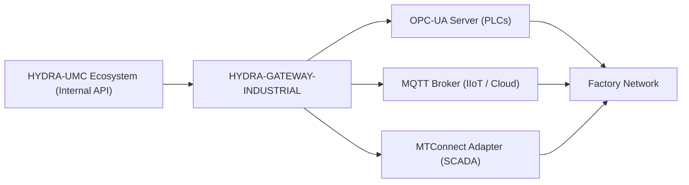

<p align="center">
  
</p>

# 🌐 HYDRA-UMC-GATEWAY-INDUSTRIAL

<p align="center"><a href="README.md">🇺🇸 English</a> | <a href="README_spa.md">🇪🇸 Español</a> | <a href="README_fra.md">🇫🇷 Français</a> | <a href="README_ita.md">🇮🇹 Italiano</a> | <a href="README_deu.md">🇩🇪 Deutsch</a> | <a href="README_zho.md">🇨🇳 简体中文</a> | <a href="README_jpn.md">🇯🇵 日本語</a> | 🇵🇹 <b>Português</b></p>

### 🏭 Ponte de interoperabilidade Indústria 4.0 para padrões de fábrica

<p align="center">
  
  
  
  
</p>

---

## 1. 🛠️ VISÃO TÉCNICA GERAL

O **HYDRA-UMC-GATEWAY-INDUSTRIAL** é a ponte de comunicação segura entre o ecossistema HYDRA-UMC e os padrões industriais externos. Permite que a microfábrica interaja com PLCs de terceiros, sistemas SCADA e plataformas IIoT na nuvem.

Funciona como um tradutor multiprotocolo, expondo os estados internos dos robôs e a telemetria das ferramentas como nós padronizados em OPC-UA, tópicos MQTT ou fluxos XML MTConnect, garantindo que o enxame Hydra nunca seja uma ilha isolada na fábrica.

### Funcionalidades principais:
* 🌐 **Suporte multipadrão:** Interfaces OPC-UA, MQTT e MTConnect integradas.
* 🛡️ **Segurança industrial:** TLS 1.2+ real na própria API HTTP deste gateway, opcional através de ficheiros de certificado reais (`TLS_CERT_PATH`/`TLS_KEY_PATH`); acrescentar `TLS_CLIENT_CA_PATH` converte-o em TLS mútuo real, recusando o próprio handshake TLS a qualquer chamador sem um certificado assinado por essa CA - veja [`docs/API.md`](docs/API.md#security-tls--mutual-tls).
* 🔄 **Mapeamento de estado:** Tradução em tempo real do estado JSON interno da Hydra para espaços de endereços industriais padronizados. *(planeado: hoje o gateway agrega a acessibilidade dos três serviços e não traduz dados)*
* ⚡ **Alta fiabilidade:** Ponte leve dedicada otimizada para funcionamento industrial 24/7.
* 🚦 **Real v0 - Lista de comandos permitidos + contrapressão:** `POST /command` é controlado por uma lista de permissões por protocolo (negar por defeito), um limite de concorrência e um tempo-limite reais - veja a "Verificação de honestidade" abaixo para saber exatamente o que se impõe hoje.
* 🔐 **Autenticação do chamador em cada comando:** `POST /command` aceita também um `GATEWAY_JWT_SECRET` opcional - uma vez definido, cada pedido precisa de um `Authorization: Bearer <token>` válido (HS256, algoritmo fixado explicitamente) ou é rejeitado antes de chegar à lista de permissões. Independente do mTLS: isto identifica QUEM emitiu o comando, o mTLS (quando configurado) identifica o par TLS.
* 🧱 **Política de produção e resultados honestos:** O gateway recusa-se a arrancar, em qualquer ambiente (o compose define `NODE_ENV=production`), sem um `GATEWAY_JWT_SECRET` real (32+ caracteres, não de exemplo; `GATEWAY_ALLOW_ANONYMOUS=1` diz de propósito que é um gateway aberto de laboratório). O executor por defeito só sonda o filho, pelo que responde `501` com o resultado `probe_only` (não se executou nada) em vez de `accepted`; um `publish` MQTT só pode ir para o espaço próprio do gateway (`hydra/gateway/#`, ou `GATEWAY_MQTT_PUBLISH_TOPICS`) e nunca para um tópico de comandos de uma ponte (`hydra/bridges/...`) nem para `$SYS`; `GATEWAY_BIND_HOST` escolhe a interface. Os tokens têm de trazer `exp` e `sub` (e `aud` se `GATEWAY_JWT_AUDIENCE` estiver definido); o gateway escuta em 127.0.0.1, salvo se `GATEWAY_BIND_HOST` disser outra coisa. *(implementado)*

**Verificação de honestidade - o que realmente funciona hoje:** `POST /command { protocol, operation, target }` é real: a operação tem de estar explicitamente permitida para o seu protocolo (`403` se não - a v0 só permite operações de tipo leitura/publicação, nada que escreva num PLC em funcionamento), não correm mais do que um número limitado de comandos ao mesmo tempo (`429` acima disso), e um comando que não termina a tempo é reportado como expirado (`504`) em vez de ficar pendurado. O caminho de execução por defeito reutiliza as sondas de acessibilidade reais deste projeto - honesto quanto a ficar aquém de uma escrita real ao nível do protocolo OPC-UA/MQTT/MTConnect, já que nenhum dos três filhos expõe ainda uma API de comandos real. Sem `GATEWAY_JWT_SECRET` o gateway recusa-se a arrancar, a menos que `GATEWAY_ALLOW_ANONYMOUS=1` diga de propósito que é um gateway aberto de laboratório: nesse caso `POST /command` não tem qualquer autenticação do chamador para além da própria lista de permissões, e o cartaz de arranque indica-o em texto simples. Veja o `CHANGELOG.md` para saber exatamente o que foi entregue.

---

## 2. 🔄 ARQUITETURA DO GATEWAY



---

## 3. 🧱 ARQUITETURA E DECISÕES DE DESENHO

* **Porque este é o pai de integração, e não um par, dos seus 3 filhos.** O HYDRA-UMC-OPCUA-SERVER, o HYDRA-UMC-MQTT-BROKER e o HYDRA-UMC-MTCONNECT-ADAPTER traduzem todos o MESMO estado do HYDRA-UMC-SERVER para 3 protocolos industriais diferentes - ter a lógica partilhada de encaminhamento/autenticação num só sítio evita 3 traduções independentes, e potencialmente inconsistentes, do mesmo estado.
* **Porque 3 adaptadores de protocolo separados e não um gateway que faz tudo.** OPC-UA, MQTT e MTConnect são estruturalmente diferentes (espaço de endereços vs. tópicos pub/sub vs. fluxos XML de dispositivo/agente) - um processo por protocolo significa que um cliente MQTT lento ou avariado nunca afeta o OPC-UA, e cada um pode ser ativado/desativado de forma independente por implantação.
* **Porque o ponto de entrada só imprime identidade/versão e fica a escutar depois de um listener de verificação de saúde arrancar.** Fase de andaimes: provar que o processo arranca e se mantém (não apenas corre e sai, ao contrário da maioria dos outros esqueletos Node deste ecossistema) precede a lógica real de tradução de protocolos, já que um gateway real é por natureza um serviço de longa duração.
* **Como isto se encaixa no resto do ecossistema.** O pai de integração da família de Gateway Industrial - expõe o estado do próprio HYDRA-UMC-SERVER a sistemas do chão de fábrica (MES/SCADA/historiadores) que falam OPC-UA, MQTT ou MTConnect em vez da API REST/WebSocket do próprio ecossistema.
* **`GET /health` é uma sonda de vida rápida e separada - o `GET /status` já não se usa para isso.** O `/status` é um diagnóstico profundo genuíno que pode legitimamente demorar ~2s por filho inacessível; apontado diretamente a ele, o verificador de todo o ecossistema `/api/ecosystem/status` do HYDRA-UMC-SERVER (que reserva só ~800ms por sonda) dava este gateway como EM BAIXO sempre que os seus filhos estavam inacessíveis, embora o processo do gateway estivesse saudável. O `/health` responde `{ gateway, version, status: "ok" }` sem qualquer sonda a jusante, e o `service.health_path` do `hydra-umc.project.json` aponta para ele em vez de `/status`.
* **O `GET /status` faz uma verificação real e em direto em cada pedido.** O `src/probes.ts` faz uma ligação TCP real para OPC-UA/MQTT e um `GET` HTTP real para o MTConnect contra cada filho - `reachable`/`latencyMs`/`error` por filho e um `allReachable` agregado calculam-se no momento do pedido, não se devolvem de uma lista em cache ou estática. Verificado de ponta a ponta: arrancaram-se os três filhos reais, o `/status` deu-os todos como acessíveis, matou-se depois um e a chamada `/status` seguinte passou corretamente só esse filho a inacessível com um `ECONNREFUSED` real. O anfitrião/porta/URL de cada filho são configuráveis por variáveis de ambiente, com por defeito os nomes de serviço exatos que o `docker-compose.yml` já usa.
* **Porque a lista de permissões do `POST /command` nega por defeito e não permite por defeito.** Um gateway industrial que encaminha qualquer cadeia de operação que lhe entreguem é um risco no momento em que um filho expõe um caminho de escrita real - partir de "nada é permitido a menos que esteja listado" significa que acrescentar uma operação perigosa (uma escrita de nó OPC-UA, uma publicação MQTT retida de configuração) é sempre uma decisão deliberada e revisável mais tarde, nunca um valor por defeito acidental hoje.
* **Porque a autorização se verifica antes da contrapressão em `CommandDispatcher.dispatch()`.** Um comando não autorizado tem de ser rejeitado da mesma forma independentemente de quão ocupado esteja o gateway - se a capacidade se verificasse primeiro, uma operação não permitida poderia ocasionalmente passar como "accepted" (por acaso havia uma vaga livre) ou ocasionalmente parecer "apenas ocupado" (não havia), revelando informação de tempo sobre a carga do gateway numa decisão que deveria ser puramente de autorização.
* **Porque o executor de comandos por defeito reutiliza as sondas de acessibilidade em vez de um esboço que tem sempre sucesso.** O `src/probes.ts` já responde "este filho está mesmo lá" a sério - reutilizá-lo faz o `POST /command` falhar de forma honesta (`502 downstream_unreachable`) contra um filho em baixo, e responder `501 probe_only` contra um filho acessível (o filho respondeu, mas não se executou nada), em vez de reportar `accepted` por um comando que nunca poderia ter ido a lado nenhum.

---

## 📂 ESTRUTURA DE DIRETÓRIOS

```text
HYDRA-UMC-GATEWAY-INDUSTRIAL/
├── src/
│   ├── probes.ts        # Verificações reais de acessibilidade TCP/HTTP contra cada filho
│   ├── command.ts        # CommandDispatcher real: lista de permissões + contrapressão + tempo-limite
│   ├── version.ts        # Versão real do pacote em execução, lida de package.json
│   └── server.ts         # Aplicação Express: GET /status, POST /command
├── tests/               # Suite vitest real (sondas, servidor, comandos)
├── docs/               # Documentação e referência de mapeamento
├── dist/               # Saída compilada (npm run build)
├── images/             # Multimédia e diagramas
├── scripts/            # Scripts utilitários (bump-version.mjs)
├── tools/
│   ├── build_test.py    # Verificação de compilação sem versão
│   └── ci_validate.py   # Validação de manifesto/CHANGELOG/docs usada pelo CI
├── bump_manifest_version.py # Sincroniza a versão de hydra-umc.project.json com a do package.json (--sync)
├── .env.example         # Modelo de variáveis de ambiente
├── build.sh/.bat        # Sobe a versão e depois npm run build
├── build-test.sh/.bat   # Verificação de compilação sem versão (sem CHANGELOG/subida de versão)
├── dev.sh/.bat           # Executa o servidor diretamente a partir do código-fonte (tsx, sem compilação)
├── Dockerfile           # A imagem de contentor deste próprio serviço
├── docker-compose.yml   # Levanta este Gateway e os seus 3 filhos em conjunto
└── README.md
```

Serviço de rede puro, sem hardware dedicado próprio - `hardware/`, `firmware/` e `os/` são omitidos pela política de estrutura dos repositórios.

---

## 🐳 INTEGRAR AS 3 PONTES FILHAS

Este é um repositório de integração real, não apenas documentação - o `docker-compose.yml` levanta este Gateway junto dos seus três filhos (**HYDRA-UMC-OPCUA-SERVER**, **HYDRA-UMC-MQTT-BROKER**, **HYDRA-UMC-MTCONNECT-ADAPTER**) como uma só rede Docker, assumindo que os quatro repositórios estão clonados como pastas irmãs (a disposição que a organização do ecossistema no GitHub já usa). O compose exige um `.env` com `GATEWAY_JWT_SECRET`, `MQTT_AUTH_JSON` e `MQTT_ACL_JSON` (veja `.env.example`): um gateway e um broker de produção não arrancam abertos.

```bash
docker compose up --build
```

Isto inicia os 4 serviços nas mesmas portas a que cada um já se liga isoladamente: este Gateway em `8000`, OPC-UA em `4840`, MQTT em `1883`, MTConnect em `5000`. `GET http://localhost:8000/status` reporta a versão do próprio Gateway e que filhos espera alcançar.

---

## 🛠️ AMBIENTE DE DESENVOLVIMENTO

### Requisitos
- [Node.js](https://nodejs.org/) (recomendada a v20 ou superior)
- npm

### Instalação
```bash
npm install
```

### Modo de desenvolvimento
Executa o servidor de agregação diretamente com `tsx` (sem empacotador):
- **Windows:** faça duplo clique em `dev.bat` ou execute `npm run dev`
- **Linux/Mac:** execute `./dev.sh` ou `npm run dev`

### Compilação de produção
Empacota o servidor num único ficheiro implantável com o esbuild:
- **Windows:** faça duplo clique em `build.bat` ou execute `npm run build`
- **Linux/Mac:** execute `./build.sh` ou `npm run build`

Depois inicie-o com:
```bash
npm start
```

O servidor escuta em `0.0.0.0:8000` - `GET /health` é uma verificação de vida rápida sem sondagem a jusante (para onde aponta o `service.health_path` do `hydra-umc.project.json`), enquanto `GET /status` é o diagnóstico profundo real que reporta a versão do próprio Gateway mais o nome/protocolo/endpoint/acessibilidade de cada ponte filha que fronteia.

Exemplo real - um comando permitido contra um filho que não está a correr, uma operação não autorizada e um pedido malformado:

```bash
curl -X POST http://localhost:8000/command -H "Content-Type: application/json" \
  -d '{"protocol":"OPC-UA","operation":"read","target":"ns=2;s=Line1.Status"}'
# 502 {"status":"downstream_unreachable","reason":"TCP connect to opcua-server:4840 timed out after 2000ms"}

curl -X POST http://localhost:8000/command -H "Content-Type: application/json" \
  -d '{"protocol":"OPC-UA","operation":"write","target":"ns=2;s=Line1.SetPoint"}'
# 403 {"status":"rejected_unauthorized","reason":"operation \"write\" is not allowlisted for OPC-UA"}

curl -X POST http://localhost:8000/command -H "Content-Type: application/json" -d '{"protocol":"OPC-UA"}'
# 400 {"error":"protocol, operation and target are required strings"}
```

### Versionamento
Cada `npm run build` real sobe automaticamente o `version` do próprio `package.json` (`scripts/bump-version.mjs`, ligado como primeiro passo do script `build`) - um "odómetro" de base 10: patch +1 por compilação, transbordando para minor (e minor para major) depois do 9 em vez de chegar a um segmento de dois dígitos (`0.0.9` -> `0.1.0`, não `0.0.10`).

---

## 🚀 ROTEIRO
* **Fase 1:** Implementação de OPC-UA Pub/Sub para troca de dados de alta velocidade e ponte com protocolos legados.
* **Fase 2:** Cluster de brokers MQTT para gestão massiva de dispositivos IoT e elevada concorrência.
* **Fase 3:** Suporte do adaptador MTConnect para integração de máquinas CNC e PLC de vários fabricantes.
* **Fase 4:** Conformidade total de cibersegurança ISO-27001 do gateway industrial e suporte de adaptador de software Profinet.

---

## 🔗 Projetos relacionados

Este projeto faz parte do ecossistema de robótica HYDRA-UMC do mesmo autor (JuanenRac / Electro Hobby 3D). Vale a pena conhecê-los, porque um pedido pode ser, na verdade, sobre um destes e não sobre este repositório.

**Projetos filhos** — cada um é um adaptador de protocolo por onde este gateway encaminha
- **[HYDRA-UMC-OPCUA-SERVER](https://github.com/JuanenRac/HYDRA-UMC-OPCUA-SERVER)** — espaço de endereços OPC-UA real, verificado com uma sessão de cliente real do protocolo binário.
- **[HYDRA-UMC-MQTT-BROKER](https://github.com/JuanenRac/HYDRA-UMC-MQTT-BROKER)** — broker MQTT real com autenticação opcional por cliente e ACL de tópicos.
- **[HYDRA-UMC-MTCONNECT-ADAPTER](https://github.com/JuanenRac/HYDRA-UMC-MTCONNECT-ADAPTER)** — endpoints XML MTConnect `/probe` e `/current` reais com saída em modo degradado.

**Diretamente relacionados**
- **[HYDRA-UMC-SERVER](https://github.com/JuanenRac/HYDRA-UMC-SERVER)** — o back-end headless real (REST/WebSocket) com que todos os clientes de controlo realmente comunicam; a origem do estado que este gateway expõe.

**Também fazem parte do ecossistema**

*Hardware e plataforma centrais*
- **[HYDRA-UMC](https://github.com/JuanenRac/HYDRA-UMC)** — a placa-mãe física do braço robótico: anfitrião CM5 + STM32H745 de dois núcleos, que orquestra até 8 braços de ferramenta por CAN-OTA/SPI-OTA.
- **[HYDRA-UMC-OS](https://github.com/JuanenRac/HYDRA-UMC-OS)** — camada de produto reproduzível do Raspberry Pi OS para o CM5: agente só de leitura, configuração/perfis validados, aprovisionamento Wi-Fi de primeiro contacto.
- **[HYDRA-UMC-SDK](https://github.com/JuanenRac/HYDRA-UMC-SDK)** — o contrato JSON-Schema partilhado e a fronteira de portas de segurança contra a qual cada bridge valida os seus comandos.
- **[HYDRA-UMC-CONNECTOR-HUB](https://github.com/JuanenRac/HYDRA-UMC-CONNECTOR-HUB)** — registo declarativo de manifestos de adaptador e validador para conectores de máquinas externas; estende a ideia de contrato do SDK a máquinas externas sem substituir os projetos de gateway industrial.

*Backend central e clientes*
- **[HYDRA-UMC-STUDIO](https://github.com/JuanenRac/HYDRA-UMC-STUDIO)** — painel web de controlo com visualização 3D em tempo real de vários robôs.
- **[HYDRA-UMC-SUITE](https://github.com/JuanenRac/HYDRA-UMC-SUITE)** — centro de comando de enxame para desktop (PySide6) para vários servidores em simultâneo.
- **[HYDRA-UMC-ANDROID-CONTROL](https://github.com/JuanenRac/HYDRA-UMC-ANDROID-CONTROL)** — aplicação Android nativa de controlo, com início de sessão biométrico e um companheiro Wear OS emparelhado.
- **[HYDRA-UMC-IOS-CONTROL](https://github.com/JuanenRac/HYDRA-UMC-IOS-CONTROL)** — aplicação de controlo para iOS/iPadOS (Flutter) com sincronização WebSocket em tempo real.
- **[HYDRA-UMC-DSI](https://github.com/JuanenRac/HYDRA-UMC-DSI)** — interface tátil nativa para o ecrã tátil DSI de 7" integrado, executada no próprio CM5.
- **[HYDRA-UMC-EDITOR-URDF](https://github.com/JuanenRac/HYDRA-UMC-EDITOR-URDF)** — criador/editor gráfico de URDF para desktop que envia os modelos concluídos para o catálogo do STUDIO.
- **[HYDRA-UMC-EDITOR-STL](https://github.com/JuanenRac/HYDRA-UMC-EDITOR-STL)** — editor de modelos STL para desktop que transforma/substitui/remove/adiciona peças reais no mesmo catálogo de modelos que o HYDRA-UMC-EDITOR-URDF também edita.
- **[HYDRA-UMC-BRIDGE-AMR](https://github.com/JuanenRac/HYDRA-UMC-BRIDGE-AMR)** — fronteira de coordenação para frotas AGV/AMR através de um publicador MQTT VDA 5050 real.
- **[HYDRA-UMC-BRIDGE-CNC](https://github.com/JuanenRac/HYDRA-UMC-BRIDGE-CNC)** — coordenador de células CNC de alto nível com acesso real ao estado GRBL e aos bytes de controlo.
- **[HYDRA-UMC-BRIDGE-DROIDS](https://github.com/JuanenRac/HYDRA-UMC-BRIDGE-DROIDS)** — fronteira de coordenação para droides com patas/humanoides, com um emissor real de comandos para o Boston Dynamics Spot.
- **[HYDRA-UMC-BRIDGE-LASER](https://github.com/JuanenRac/HYDRA-UMC-BRIDGE-LASER)** — coordenador de segurança de células laser que lê 3 proteções reais por GPIO (chave, caixa e interlock).
- **[HYDRA-UMC-BRIDGE-OPENPNP](https://github.com/JuanenRac/HYDRA-UMC-BRIDGE-OPENPNP)** — coordenador seguro de fluxo de placa de alto nível para pick-and-place com OpenPnP.
- **[HYDRA-UMC-BRIDGE-PRINTER3D](https://github.com/JuanenRac/HYDRA-UMC-BRIDGE-PRINTER3D)** — fronteira de coordenação segura para impressoras 3D Moonraker/Klipper, com comandos de trabalho reais protegidos por portas.
- **[HYDRA-UMC-BRIDGE-ROS2](https://github.com/JuanenRac/HYDRA-UMC-BRIDGE-ROS2)** — coordenador de segurança com um transporte ROS 2 real baseado em rclpy importado sob demanda.
- **[HYDRA-UMC-BRIDGE-UAV](https://github.com/JuanenRac/HYDRA-UMC-BRIDGE-UAV)** — fronteira de coordenação para UAV com câmara, com um emissor real de comandos MAVLink.

*Plataforma de ferramentas URTC*
- **[URTC](https://github.com/JuanenRac/URTC)** — firmware da placa física Universal Robot Tool Controller, mais de 25 perfis de ferramenta por barramento CAN.
- **[URTC-FLASHER](https://github.com/JuanenRac/URTC-FLASHER)** — ferramenta gráfica de gravação para desktop das placas URTC, por CAN-OTA e também SWD/JTAG de chip completo.
- **[URTC-TESTER](https://github.com/JuanenRac/URTC-TESTER)** — ferramenta de diagnóstico CAN em tempo real para desktop das placas URTC, com um painel por perfil de ferramenta.
- **[URTC-WEB-STUDIO](https://github.com/JuanenRac/URTC-WEB-STUDIO)** — alternativa no navegador ao URTC-TESTER através da Web Serial API, sem instalação local.

*Nó de IA de visão (Hailo-8)*
- **[HYDRA-UMC-VISION-NODE](https://github.com/JuanenRac/HYDRA-UMC-VISION-NODE)** — centro de integração do pipeline de visão Hailo-8, com uma verificação real de prontidão de hardware por fase.
- **[HYDRA-UMC-DETECTION-HEF](https://github.com/JuanenRac/HYDRA-UMC-DETECTION-HEF)** — registo real de modelos compilados com verificação segura de carga por arquitetura Hailo e soma de verificação.
- **[HYDRA-UMC-VISION-STREAMER](https://github.com/JuanenRac/HYDRA-UMC-VISION-STREAMER)** — pipeline GStreamer real e gerador de configuração MediaMTX com uma fronteira de integração HailoRT real.
- **[HYDRA-UMC-VISUAL-SERVOING-API](https://github.com/JuanenRac/HYDRA-UMC-VISUAL-SERVOING-API)** — lei de correção real de servovisão baseada em posição, protegida pelo estado da zona a montante.
- **[HYDRA-UMC-SAFETY-ZONES](https://github.com/JuanenRac/HYDRA-UMC-SAFETY-ZONES)** — verificação real de violação de zonas e pedido de E-STOP, com exigência de calibração recente.

*Nó de IA cognitiva (Hailo-10)*
- **[HYDRA-UMC-COGNITIVE-NODE](https://github.com/JuanenRac/HYDRA-UMC-COGNITIVE-NODE)** — centro de integração do pipeline cognitivo do Hailo-10 (orquestração de LLM/VLA/voz).
- **[HYDRA-UMC-VLA-ENGINE](https://github.com/JuanenRac/HYDRA-UMC-VLA-ENGINE)** — codificação/descodificação real de tokens de ação e geração de trajetórias para um modelo Visão-Linguagem-Ação.
- **[HYDRA-UMC-VOICE-UI](https://github.com/JuanenRac/HYDRA-UMC-VOICE-UI)** — front-end de voz real (VAD + analisador de intenções) com um relé para o relógio limitado e protegido por confirmação.
- **[HYDRA-UMC-SEMANTIC-PLANNER](https://github.com/JuanenRac/HYDRA-UMC-SEMANTIC-PLANNER)** — decomposição real de tarefas baseada em regras e recuperação semântica de erros sobre os códigos de erro do MCU.
- **[HYDRA-UMC-DOCS-QA](https://github.com/JuanenRac/HYDRA-UMC-DOCS-QA)** — pesquisa real de documentos TF-IDF só com a biblioteca padrão sobre a documentação Markdown deste ecossistema.
- **[HYDRA-UMC-LOCAL-TECHNICIAN](https://github.com/JuanenRac/HYDRA-UMC-LOCAL-TECHNICIAN)** — técnico de manutenção de IA local, protegido por políticas, para o próprio ecossistema: observa, diagnostica e propõe correções; os dois níveis de maior risco não estão implementados de propósito.

*Orquestração e enxame*
- **[HYDRA-UMC-ORCHESTRATOR](https://github.com/JuanenRac/HYDRA-UMC-ORCHESTRATOR)** — centro de integração com um contrato real de relatório de saúde gRPC/Protobuf e uma máquina de estados de missões.
- **[HYDRA-UMC-JOB-DISPATCHER](https://github.com/JuanenRac/HYDRA-UMC-JOB-DISPATCHER)** — fila real de trabalhos por prioridade com deduplicação, sobre uma API HTTP real.
- **[HYDRA-UMC-NODE-HEALING](https://github.com/JuanenRac/HYDRA-UMC-NODE-HEALING)** — vigilante real de saúde da frota por gRPC com repetição/recuo e deteção de identidade incoerente.
- **[HYDRA-UMC-PATH-PLANNER-3D](https://github.com/JuanenRac/HYDRA-UMC-PATH-PLANNER-3D)** — planeador real de trajetórias 3D baseado em RRT com validação real de colisões com obstáculos e espaço de trabalho.
- **[HYDRA-UMC-SWARM-SYNC](https://github.com/JuanenRac/HYDRA-UMC-SWARM-SYNC)** — sincronização real de estado CRDT LWW-Element-Map, testada por propriedades para a convergência de várias células.

*Gémeo digital e simulação*
- **[HYDRA-UMC-TWIN](https://github.com/JuanenRac/HYDRA-UMC-TWIN)** — centro de integração do motor de gémeo digital, com um contrato real de sincronização de compatibilidade de versões.
- **[HYDRA-UMC-HIL-BRIDGE](https://github.com/JuanenRac/HYDRA-UMC-HIL-BRIDGE)** — interlock de segurança real de hardware-in-the-loop que encaminha comandos entre a simulação e o hardware real.
- **[HYDRA-UMC-PHYSICS-REPLICA](https://github.com/JuanenRac/HYDRA-UMC-PHYSICS-REPLICA)** — cinemática direta real e validação de limites de juntas sobre um subconjunto real de URDF.
- **[HYDRA-UMC-SYNTHETIC-DATA-GEN](https://github.com/JuanenRac/HYDRA-UMC-SYNTHETIC-DATA-GEN)** — gerador procedural real de cenas 2D com exportação de anotações YOLO/COCO.

*Dados e análise*
- **[HYDRA-UMC-DATALAKE](https://github.com/JuanenRac/HYDRA-UMC-DATALAKE)** — armazém real de séries temporais sobre sqlite3 com uma API HTTP real de ingestão/consulta.
- **[HYDRA-UMC-ANOMALY-DETECTOR](https://github.com/JuanenRac/HYDRA-UMC-ANOMALY-DETECTOR)** — detetor real de anomalias por FFT e linha de base estatística, com monitorização de deriva.
- **[HYDRA-UMC-PRODUCTION-REPORTS](https://github.com/JuanenRac/HYDRA-UMC-PRODUCTION-REPORTS)** — cálculo real de OEE/disponibilidade sobre o histórico do DATALAKE, com exportação CSV reprodutível.
- **[HYDRA-UMC-TELEMETRY-COLLECTOR](https://github.com/JuanenRac/HYDRA-UMC-TELEMETRY-COLLECTOR)** — pipeline real de ingestão CAN/WebSocket para o DATALAKE, com deduplicação por sequência.

*Ferramentas complementares e operações do ecossistema*
- **[HYDRA-UMC-DASHBOARD-AI](https://github.com/JuanenRac/HYDRA-UMC-DASHBOARD-AI)** — painéis de Resumos Inteligentes e Realce de Anomalias sobre o DATALAKE/ANOMALY-DETECTOR, com um recurso estatístico honesto.
- **[HYDRA-UMC-TOOL-CLI](https://github.com/JuanenRac/HYDRA-UMC-TOOL-CLI)** — CLI da frota com um contrato de códigos de saída real e estável, um cliente vivo genuíno da API do HYDRA-UMC-SERVER.
- **[HYDRA-UMC-WATCH](https://github.com/JuanenRac/HYDRA-UMC-WATCH)** — aplicação companheira WearOS com alertas hápticos reais e um relé de voz para o telemóvel emparelhado.
- **[URTC-SMART-RACK](https://github.com/JuanenRac/URTC-SMART-RACK)** — firmware de um rack de montagem de placas com descodificação real do ID da ferramenta e lógica de pré-aquecimento Smart Idle.
- **[URTC-VISION-TOOL](https://github.com/JuanenRac/URTC-VISION-TOOL)** — firmware mais um companheiro de visão em Python real para uma cabeça de ferramenta de inspeção térmica/RGB.
- **[HYDRA-UMC-UPDATER](https://github.com/JuanenRac/HYDRA-UMC-UPDATER)** — ferramenta administrativa de desktop que descobre, clona e atualiza todos os repositórios deste ecossistema.
- **[HYDRA-UMC-OS-REBUILDER](https://github.com/JuanenRac/HYDRA-UMC-OS-REBUILDER)** — ferramenta de desktop para Windows/Linux que constrói uma imagem do CM5 pronta a gravar com as versões mais recentes do ecossistema, com configuração de primeiro arranque de Wi-Fi/utilizador/SSH ao estilo do Raspberry Pi Imager.
- **[HYDRA-UMC-OPS-AGENT](https://github.com/JuanenRac/HYDRA-UMC-OPS-AGENT)** — coordenador de incidentes de manutenção: um papel de borda de poucos privilégios recolhe um inventário/estado higienizado, um papel de plano de controlo mostra-o só de leitura e pede a um fornecedor de IA que sugira um diagnóstico; nunca aplica um patch nem implanta nada.
- **[HYDRA-UMC-DEV-SERVER](https://github.com/JuanenRac/HYDRA-UMC-DEV-SERVER)** — anfitrião de desenvolvimento reproduzível (Raspberry Pi 5 / CM5) que guarda o código-fonte do ecossistema e executa tarefas limitadas de compilação/teste numa fila durável; um papel de desenvolvimento dedicado, explicitamente não um CM5 operacional.

---

## 📚 Documentação e comunidade

- **[docs/API.md](docs/API.md)** — a referência real da API HTTP: a sonda de vida rápida `GET /health`, cada campo de resposta de `GET /status`, a fronteira `403`/`429`/`501`/`504`/`502` de `POST /command` e cada variável de ambiente de configuração, documentadas diretamente a partir de `src/server.ts`/`src/probes.ts`.
- **[CONTRIBUTING.md](CONTRIBUTING.md)** — pilha tecnológica e diretrizes de código para um pull request.
- **[CODE_OF_CONDUCT.md](CODE_OF_CONDUCT.md)** — as normas de comportamento esperadas nesta comunidade.
- **[SECURITY.md](SECURITY.md)** — como comunicar uma vulnerabilidade e as áreas de segurança em que este projeto se concentra.
- **[SUPPORT.md](SUPPORT.md)** — onde fazer perguntas e comunicar erros.
- **[LICENSE.md](LICENSE.md)** — a licença deste projeto.

## 👤 AUTOR
**JuanenRac** (Electro Hobby 3D)
📧 electrohobby3d@gmail.com
📺 [youtube.com/@electrohobby3d](https://youtube.com/@electrohobby3d)

## 📜 LICENÇA
GPL-3.0-or-later - consulte LICENSE para mais detalhes.

